<p align="center">
  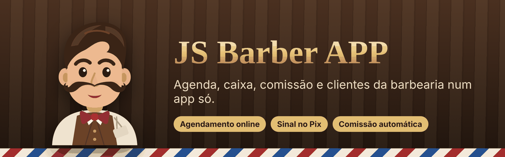
</p>

<p align="center">
  
  
  
  
  
</p>

<p align="center">
  <b>O sistema completo pra barbearia:</b> o cliente agenda pelo link, paga o sinal no Pix,<br>
  o barbeiro atende com a ficha na mão e o dono vê quanto entrou, quanto saiu e quanto foi pra equipe.
</p>

---

## Sumário

- [O que é](#o-que-é)
- [Telas](#telas)
- [Funcionalidades](#funcionalidades)
- [Como funciona](#como-funciona)
- [Segurança e privacidade](#segurança-e-privacidade)
- [Tecnologia](#tecnologia)
- [Próximos passos](#próximos-passos)

---

## O que é

O **JS Barber APP** é um sistema de gestão pra barbearias que funciona no navegador e se instala na tela do celular como um aplicativo. Um único sistema atende várias barbearias: cada uma tem o próprio espaço, a própria marca e o próprio link de agendamento, e nenhuma enxerga os dados da outra.

São três aplicativos em um:

| | Pra quem | O que faz |
|---|---|---|
| **Painel da barbearia** | Dono e barbeiros | Agenda, caixa, comissões, clientes, estoque, horários e configurações |
| **Página de agendamento** | Cliente final | Escolhe serviço, barbeiro, dia e hora, e paga o sinal no Pix ou no cartão. Sem precisar de conta |
| **Painel do administrador** | Dono do sistema | Todas as barbearias assinantes, mensalidades, testes grátis e bloqueios |

E quem recebe o cliente é o **mascote**, um barbeiro bigodudo que dá bom dia, pisca, mexe o bigode e comemora cada comanda fechada.

---

## Telas

<table>
  <tr>
    <td align="center">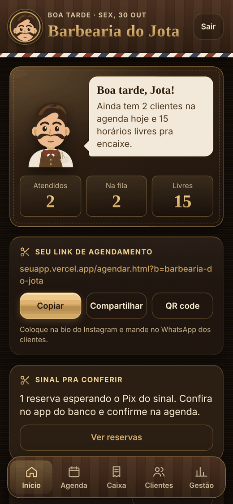<br><sub><b>Início</b> · resumo do dia</sub></td>
    <td align="center">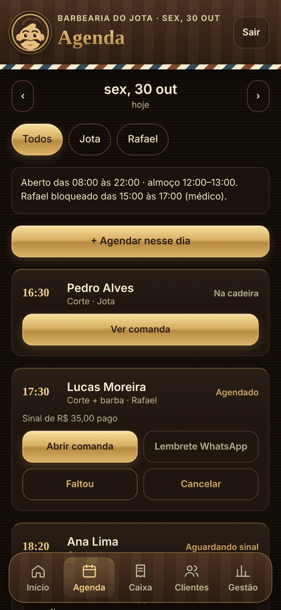<br><sub><b>Agenda</b> · horários e sinais</sub></td>
    <td align="center">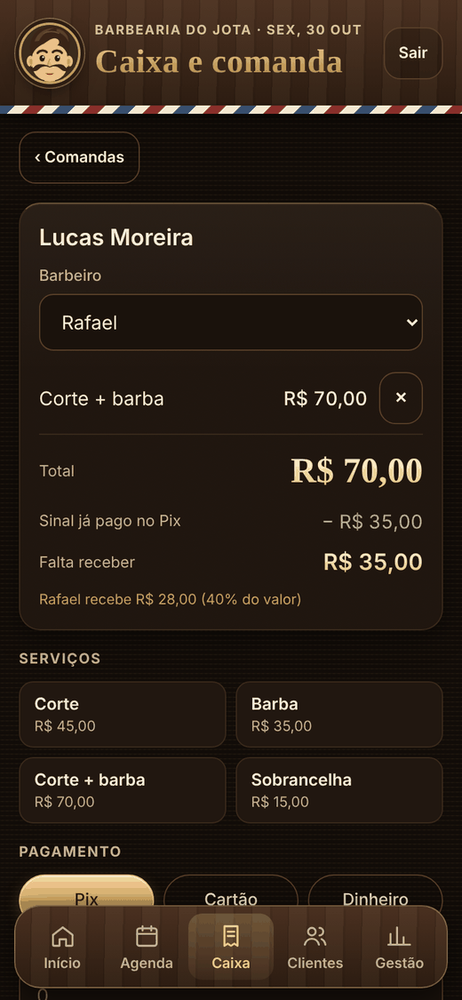<br><sub><b>Comanda</b> · com o sinal descontado</sub></td>
  </tr>
  <tr>
    <td align="center"><br><sub><b>Caixa</b> · fechamento do dia</sub></td>
    <td align="center">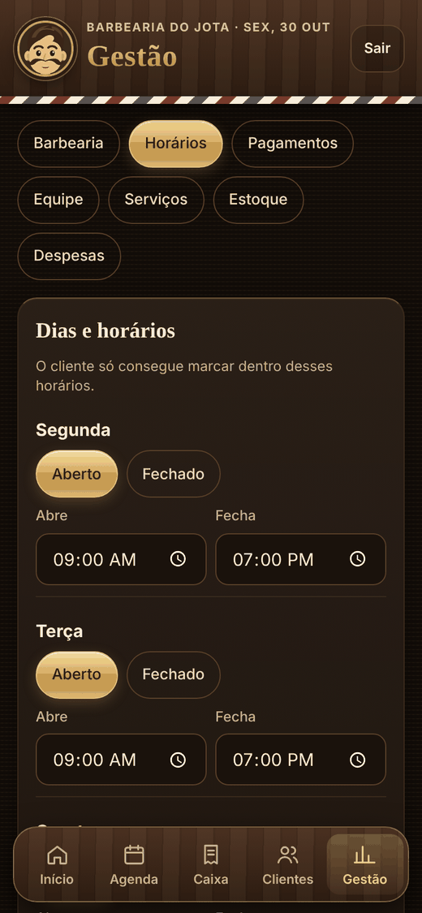<br><sub><b>Horários</b> · dias, almoço e folgas</sub></td>
    <td align="center">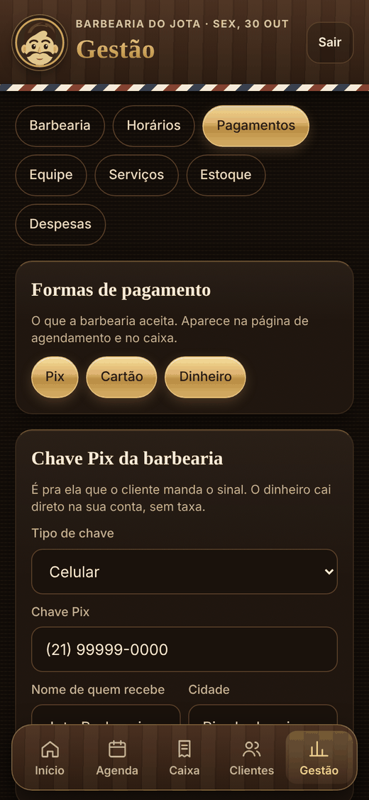<br><sub><b>Pagamentos</b> · chave Pix e sinal</sub></td>
  </tr>
  <tr>
    <td align="center">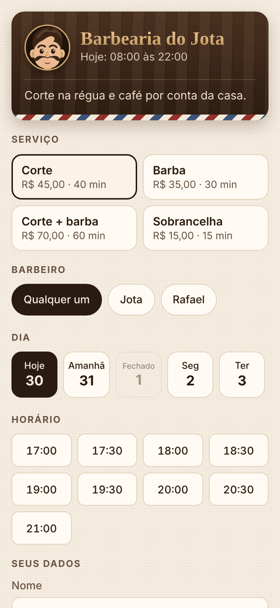<br><sub><b>Cliente agenda</b> pelo link</sub></td>
    <td align="center">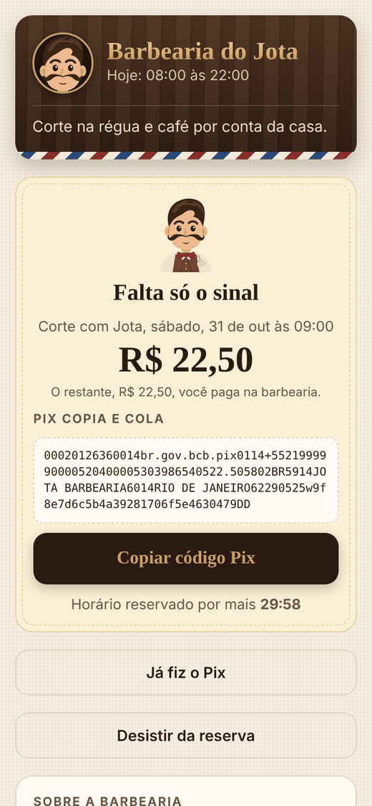<br><sub><b>Sinal no Pix</b> · copia e cola</sub></td>
    <td align="center"><br><sub><b>App do barbeiro</b> · agenda e ganhos</sub></td>
  </tr>
  <tr>
    <td align="center">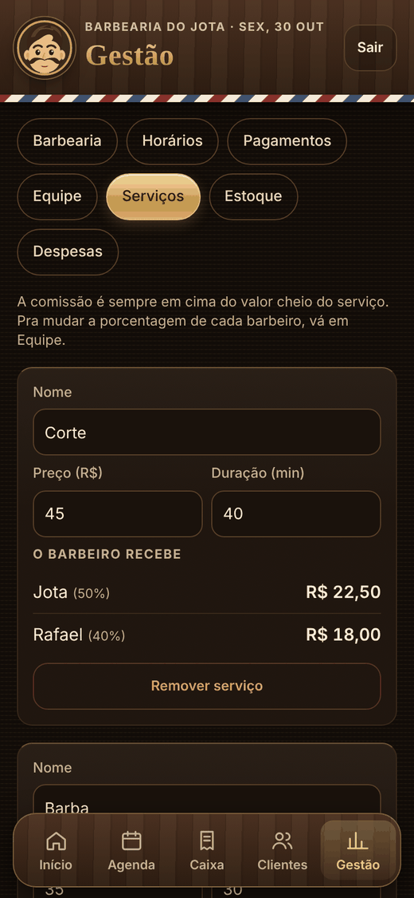<br><sub><b>Serviços</b> · quanto cada um recebe</sub></td>
    <td align="center">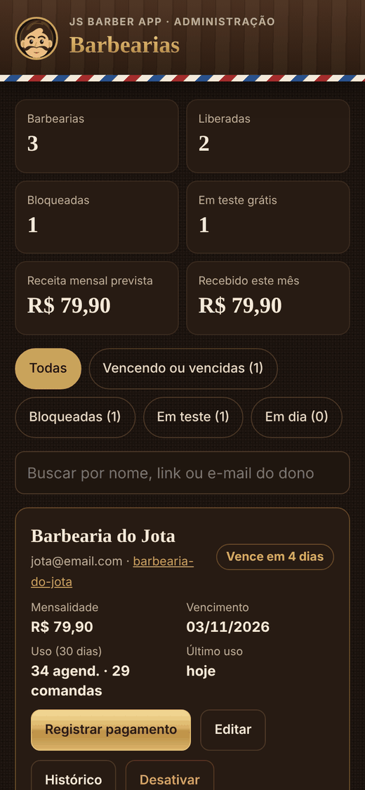<br><sub><b>Administrador</b> · assinaturas</sub></td>
    <td align="center">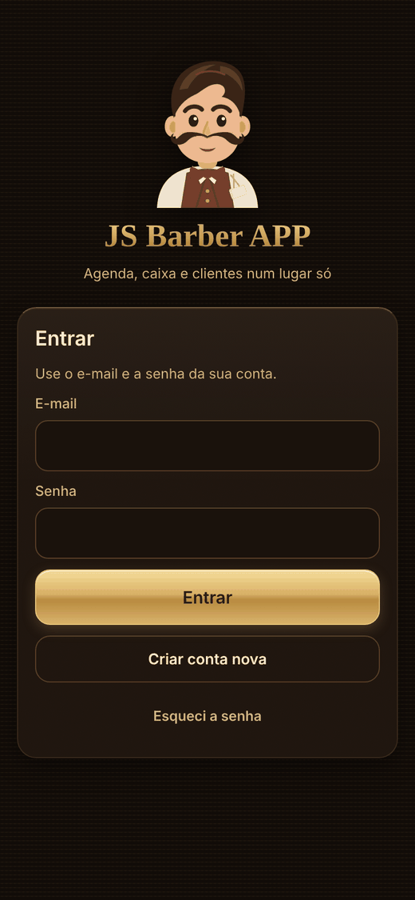<br><sub><b>Entrada</b> · com o mascote</sub></td>
  </tr>
</table>

---

## Funcionalidades

### Início
- Saudação do mascote com o resumo do dia: quantos foram atendidos, quantos estão na fila e quantos horários estão livres.
- **Agora**: quem está na cadeira e quem é o próximo, com o botão da comanda ali mesmo.
- **Link de agendamento** com os botões Copiar, Compartilhar e QR code, e quantos agendamentos chegaram por ele hoje.
- Dinheiro de hoje (entrou, saiu e foi pra equipe) e o mês (projeção, faturado, ticket médio, clientes e frequência de volta).
- **Hora do extra**: mostra o próximo horário livre e já entrega a mensagem pronta pra mandar no WhatsApp.
- **Quem parou de vir**: clientes que passaram do tempo normal de volta.
- Aviso de mensalidade perto de vencer.

### Agenda
- Visão por dia e por barbeiro, com o resumo do expediente (horário, almoço, folgas e bloqueios).
- Abrir comanda, marcar falta, cancelar e mandar **lembrete no WhatsApp** com a mensagem pronta.
- Reservas **aguardando sinal** com o prazo, e o botão "Sinal recebido" pra confirmar.
- Agendamento pelo balcão, que respeita as mesmas regras de horário da página do cliente.

### Caixa e comanda
- Comanda com serviços e produtos, pagamento em Pix, cartão ou dinheiro, e gorjeta separada pro barbeiro.
- **Comissão calculada sozinha**, sempre em cima do valor cheio do serviço.
- O sinal pago no Pix já aparece descontado, mostrando só o que falta receber.
- Fechamento do dia por forma de pagamento.
- O produto vendido sai do estoque automaticamente.
- O mascote comemora com confete quando a comanda fecha.

### Clientes
- Ficha de cada cliente: como gosta do corte, observações, visitas e última vez que veio.
- O app aprende de quanto em quanto tempo cada cliente volta e avisa quando alguém **sumiu**, com a mensagem pra chamar de volta no WhatsApp.
- Clientes entram sozinhos quando agendam pelo link ou pelo balcão.

### Horários
- Horário diferente pra cada dia da semana, e dias fechados.
- Pausa pro almoço.
- **Folga semanal** de cada barbeiro.
- **Bloqueio** de um dia inteiro ou só de um período, pra barbearia toda ou pra um barbeiro (feriado, médico, compromisso).
- Tudo vale ao mesmo tempo no painel, na página do cliente e no servidor.

### Pagamentos e sinal no Pix
- Formas de pagamento aceitas pela barbearia.
- Chave Pix da barbearia, com teste de R$ 1,00 pra conferir o nome no app do banco.
- **Sinal pra agendar**: o cliente paga 20%, 30%, 50% ou 100% do serviço no Pix pra garantir o horário.
- O horário fica reservado enquanto o cliente paga (15, 30 ou 60 minutos) e é liberado sozinho se o prazo acabar.
- O dinheiro cai direto na conta da barbearia, sem intermediário e sem taxa.

### Cartão de crédito e Pix automático (Mercado Pago)
- Cada barbearia **conecta a própria conta Mercado Pago** com um botão, sem copiar chave nenhuma.
- O cliente paga o sinal (ou o valor todo, com 100%) **no cartão de crédito ou no Pix** na hora de agendar.
- **Confirmação automática**: pagamento aprovado e o horário fica marcado sozinho, sem o dono conferir nada.
- Parcelamento do sinal em até 12x, à escolha do dono. O dinheiro cai na conta Mercado Pago da barbearia.
- Os dados do cartão vão direto pro Mercado Pago e nunca passam pelo app.
- Se um pagamento chegar depois de a reserva cair, o painel avisa pra devolver ou remarcar.

### Página de agendamento do cliente
- Sem cadastro e sem senha: serviço, barbeiro (ou "qualquer um"), dia e horário em poucos toques.
- Mostra só horários realmente livres, e marca os dias fechados.
- QR code e Pix "copia e cola" do sinal, com contagem regressiva, botão pra mandar o comprovante no WhatsApp e confirmação automática na tela quando a barbearia confirma o Pix.
- Logo, cor, mensagem de boas-vindas, endereço com mapa, Instagram e WhatsApp da barbearia.
- Estilo claro ou escuro, à escolha do dono.

### Equipe e comissões
- Comissão de cada barbeiro em serviços e em produtos, com exemplo de quanto ele recebe.
- Vales (adiantamentos) e gorjetas, com o valor a receber no fim do mês.
- Convite por e-mail: cada pessoa entra com a própria conta e é ligada a um barbeiro da agenda.
- **Permissões**: o barbeiro vê a agenda, os clientes e só os próprios ganhos e comandas. O caixa da barbearia, as despesas e os ganhos dos colegas ficam com o dono.

### App do barbeiro
- Agenda do dia com a **ficha de cada cliente**.
- Quanto já ganhou hoje e no mês, com comissão, gorjetas e vales.
- Chamar pra cadeira e fechar a comanda dos próprios clientes.

### Avisos de agendamento
- Quando um cliente marca pelo link: aviso na tela com o mascote, som, vibração e notificação do celular.
- Contador de novos agendamentos na aba Agenda.

### Gestão
- Serviços com preço e duração.
- Estoque com alerta de mínimo.
- Despesas e "quanto sobrou no mês".
- Perfil da barbearia: logo, nome, cor, mensagem, endereço e redes.
- Botão Sair no cabeçalho e menu da conta ao tocar no mascote.

### Painel do administrador (dono do sistema)
- Todas as barbearias, com o dono, o uso dos últimos 30 dias e a situação: em teste, em dia, vencendo ou bloqueada.
- Receita mensal prevista e recebida no mês.
- Registrar pagamento, editar mensalidade e vencimento, desativar e reativar, com histórico de pagamentos.
- **10 dias de teste grátis** pra toda barbearia nova.
- **Bloqueio automático** depois de 5 dias de mensalidade vencida, sem apagar nenhum dado. O acesso volta na hora em que o pagamento é registrado.

---

## Como funciona

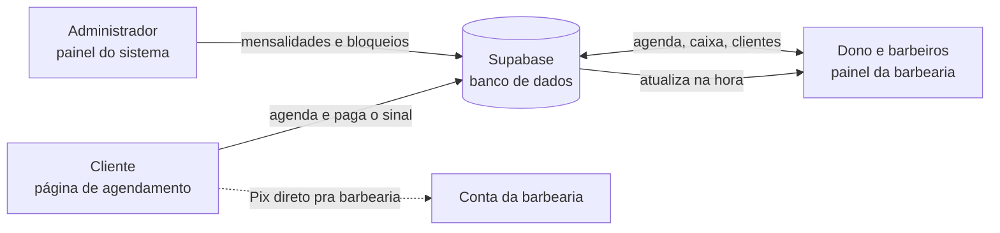

- Tudo acontece em tempo real: o que o cliente marca aparece na hora na agenda, e o que um barbeiro fecha no caixa aparece no celular do dono.
- O servidor confere cada agendamento: horário livre, dentro do expediente, fora do almoço, das folgas e dos bloqueios, e calcula o valor do sinal ele mesmo.

---

## Segurança e privacidade

- **Cada barbearia só acessa os próprios dados**, com regras no banco de dados, não só escondendo na tela.
- O **barbeiro** não consegue ler nem alterar comandas de outro barbeiro, despesas ou vales.
- O **cliente**, sem login, só vê o perfil público da barbearia e quais horários estão ocupados (sem nomes). Comissões, custos e dados de outros clientes nunca aparecem pra ele.
- Cada WhatsApp só pode segurar uma reserva aguardando sinal por vez, pra ninguém travar a agenda.
- Só o administrador muda vencimento, mensalidade e bloqueio de uma barbearia.
- As chaves do Mercado Pago de cada barbearia ficam numa tabela que nenhum navegador consegue ler. O valor cobrado vem sempre do servidor, e um pagamento só confirma o horário depois de conferido direto no Mercado Pago.

---

## Tecnologia

| Parte | O que usa |
|---|---|
| Telas | HTML, CSS e JavaScript puros, sem framework. Instalável no celular (PWA) |
| Banco de dados, login e tempo real | [Supabase](https://supabase.com) (Postgres com regras de acesso por linha) |
| Hospedagem | [Vercel](https://vercel.com) |
| Pix | Código "copia e cola" no padrão do Banco Central, gerado no próprio app (`pix.js`) |
| Cartão e Pix automático | [Mercado Pago](https://www.mercadopago.com.br/developers) (OAuth, Card Payment Brick e API de pagamentos) em Supabase Edge Functions |
| QR codes | qrcodejs |
| Mascote e ícones | Desenhados em SVG |

```
├── index.html          Painel da barbearia (dono e barbeiros)
├── agendar.html        Página de agendamento do cliente
├── admin.html          Painel do administrador do sistema
├── pix.js              Gerador do Pix "copia e cola"
├── config.js           Endereço e chave pública do Supabase
├── supabase/schema.sql Banco de dados, regras de acesso e funções
├── supabase/functions/ Conexão e cobrança do Mercado Pago (mp-oauth, mp-pagar, mp-webhook)
├── manifest.webmanifest, *.png   Nome e ícone do app no celular
└── docs/               Imagens deste README e guia técnico
```

---

## Próximos passos

- [x] Cartão de crédito e Pix automático pelo Mercado Pago, com confirmação automática do pagamento
- [ ] Aviso de agendamento com o app fechado (notificação push)
- [ ] Lembrete automático no WhatsApp pela API oficial
- [ ] Clube de assinatura pros clientes da barbearia
- [ ] Cobrança das mensalidades pelo WhatsApp com Pix, e planos com preço automático no admin
- [ ] Emissão de nota fiscal (NFS-e)

---

<p align="center">
  <br>
  <sub>Feito por <a href="https://github.com/SalesDevFull">SalesDevFull</a> · O guia técnico de instalação está em <a href="docs/INSTALACAO.md">docs/INSTALACAO.md</a></sub>
</p>
