<p align="center">
  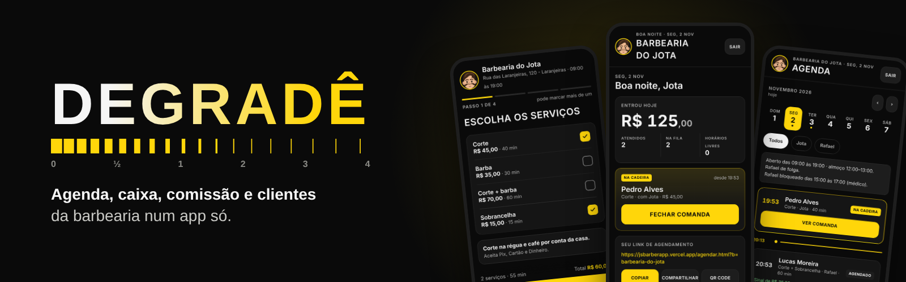
</p>

<p align="center">
  
  
  
  
  
</p>

<p align="center">
  <b>O sistema completo pra barbearia:</b> o cliente agenda pelo link e paga o sinal no Pix ou no cartão,<br>
  o barbeiro atende com a ficha na mão e o dono vê quanto entrou e quanto foi pra equipe.
</p>

---

## Sumário

- [O que é](#o-que-é)
- [Visual](#visual)
- [Telas](#telas)
- [Funcionalidades](#funcionalidades)
- [Como funciona](#como-funciona)
- [Segurança e privacidade](#segurança-e-privacidade)
- [Tecnologia](#tecnologia)
- [Histórico de mudanças](#histórico-de-mudanças)
- [Próximos passos](#próximos-passos)

---

## O que é

O **Degradê** é um sistema de gestão pra barbearias que funciona no navegador e se instala na tela do celular como um aplicativo. Um único sistema atende várias barbearias: cada uma tem o próprio espaço, a própria marca e o próprio link de agendamento, e nenhuma enxerga os dados da outra.

São três aplicativos em um:

| | Pra quem | O que faz |
|---|---|---|
| **Painel da barbearia** | Dono e barbeiros | Agenda, caixa, comissões, clientes, horários e configurações |
| **Página de agendamento** | Cliente final | Escolhe um ou mais serviços, barbeiro, dia e hora, e paga o sinal no Pix ou no cartão. Sem precisar de conta |
| **Painel do administrador** | Dono do sistema | Todas as barbearias assinantes, planos, mensalidades, testes grátis e bloqueios |

E quem recebe o cliente é o **mascote**, um barbeiro bigodudo que dá boa noite, pisca, mexe o bigode e comemora cada comanda fechada.

---

## Visual

- **Nome e marca:** Degradê. Na tela de entrada, o nome sai do branco pro amarelo, como um degradê de verdade, com a **régua dos pentes** embaixo (0, ½, 1, 2, 3, 4).
- **Ícone do app:** barras arredondadas que afinam e apagam da esquerda pra direita, em amarelo sobre preto.
- **Cores:** fundo preto (#0A0A0A) com um destaque só, que é a cor da barbearia (amarelo #FFD60A por padrão, ou uma das 7 cores da paleta). O texto em cima do destaque fica preto ou branco sozinho, pra sempre dar leitura.
- **Letra:** Bai Jamjuree. Títulos e botões em maiúsculas, nomes de clientes e serviços em letra normal.
- **Versão clara do painel:** cada pessoa escolhe Escuro ou Claro em **Aparência do app**, e vale só pro celular dela.
- **Página do cliente:** estilo escuro ou claro, à escolha do dono.
- **Navegação:** abas fixas embaixo, num cartão flutuante, com alvos de toque grandes.

---

## Telas

<table>
  <tr>
    <td align="center">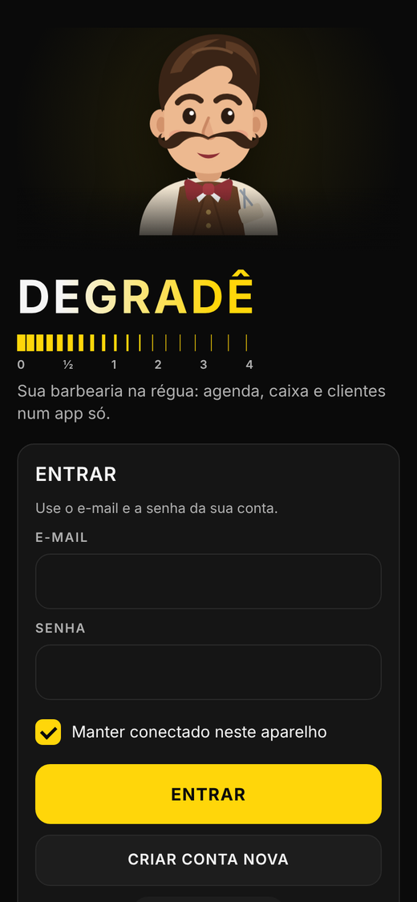<br><sub><b>Entrada</b> · régua dos pentes e manter conectado</sub></td>
    <td align="center">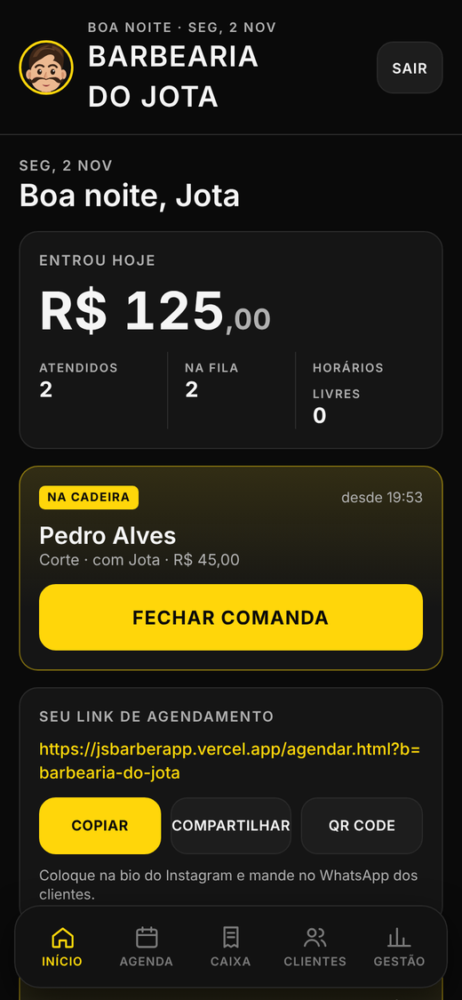<br><sub><b>Início</b> · faturado, na cadeira e próximos</sub></td>
    <td align="center">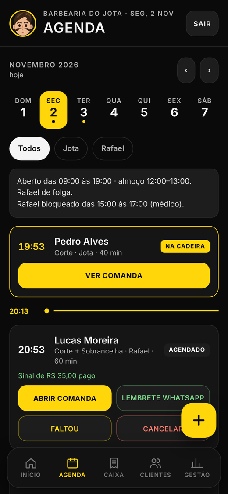<br><sub><b>Agenda</b> · semana, linha do agora e encaixe</sub></td>
  </tr>
  <tr>
    <td align="center">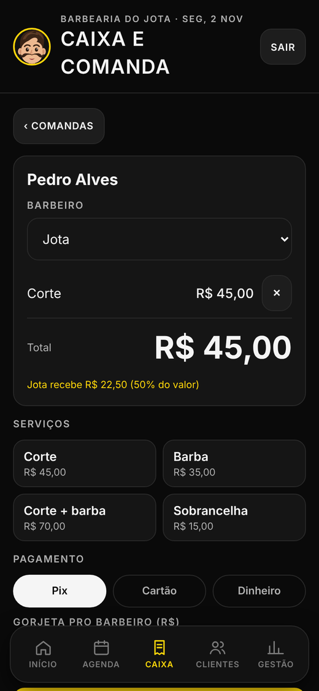<br><sub><b>Comanda</b> · um item por serviço</sub></td>
    <td align="center">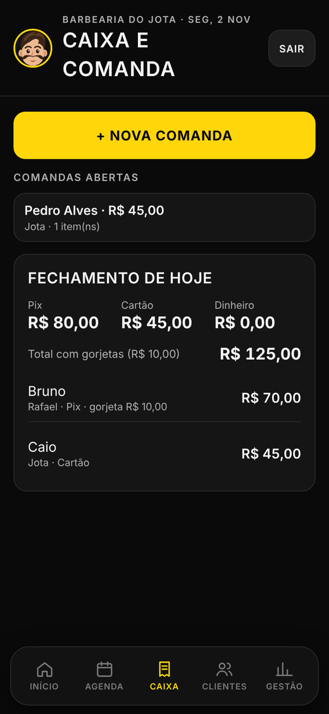<br><sub><b>Caixa</b> · fechamento do dia</sub></td>
    <td align="center">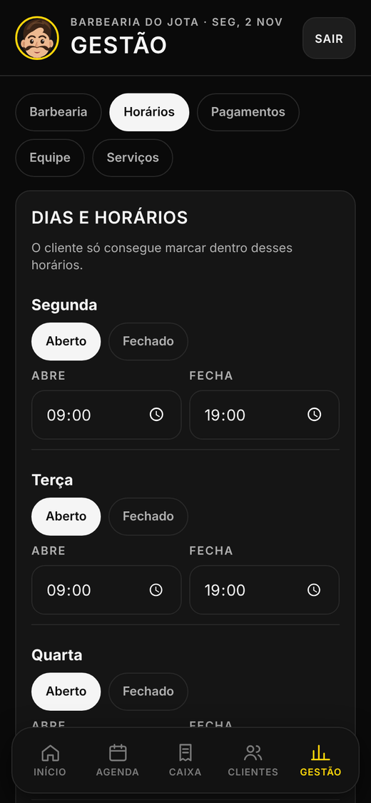<br><sub><b>Horários</b> · dias, almoço e folgas</sub></td>
  </tr>
  <tr>
    <td align="center">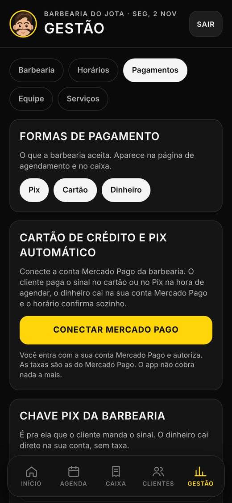<br><sub><b>Pagamentos</b> · Mercado Pago, Pix e sinal</sub></td>
    <td align="center">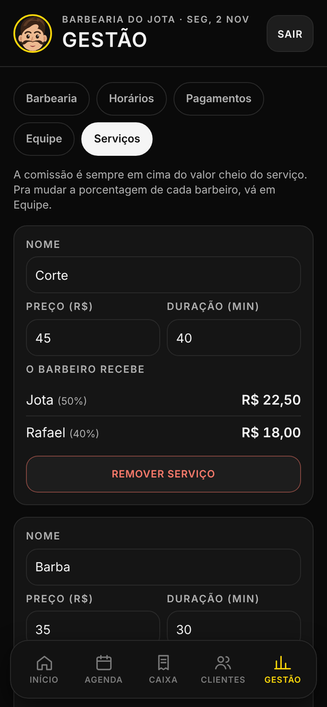<br><sub><b>Serviços</b> · quanto cada barbeiro recebe</sub></td>
    <td align="center">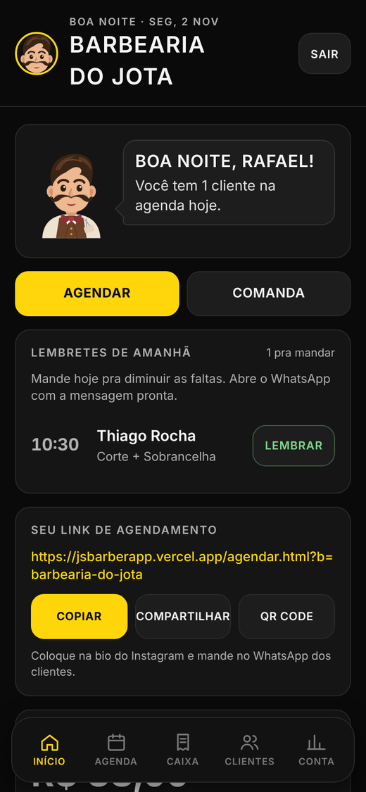<br><sub><b>App do barbeiro</b> · só a agenda dele</sub></td>
  </tr>
  <tr>
    <td align="center">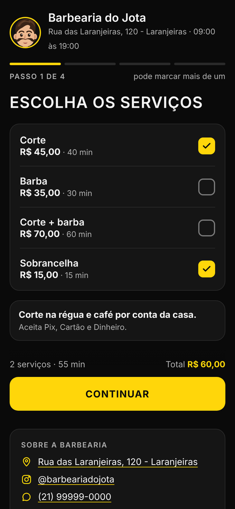<br><sub><b>Cliente agenda</b> · vários serviços</sub></td>
    <td align="center">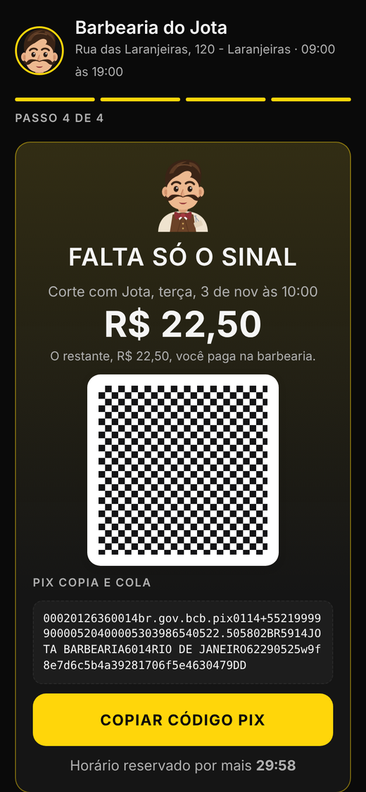<br><sub><b>Sinal no Pix</b> · copia e cola</sub></td>
    <td align="center">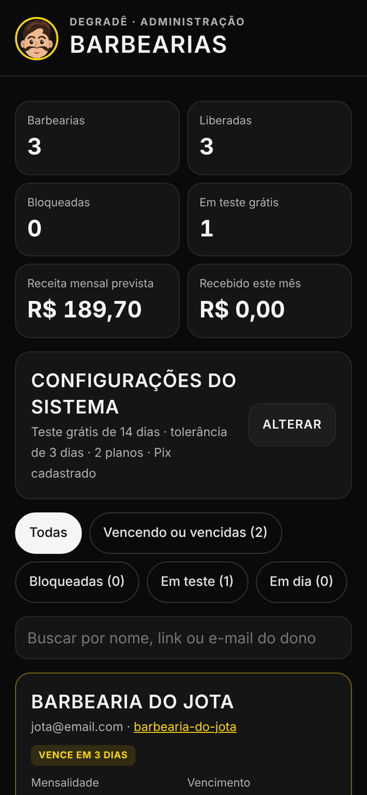<br><sub><b>Administrador</b> · assinaturas</sub></td>
  </tr>
</table>

---

## Funcionalidades

### Entrada
- Login com e-mail e senha, **Manter conectado neste aparelho** (marcado por padrão; desmarcado, sai ao fechar o navegador) e "Esqueci a senha".
- O navegador oferece salvar a senha logo ao entrar, e não depois, no meio do uso (Chrome, Android e iPhone).
- Links pros termos de uso e a política de privacidade.

### Início
- Cartão do **faturado hoje**, com atendidos, fila e horários livres.
- **Na cadeira**: quem está sendo atendido, com o botão **Fechar comanda** ali mesmo.
- **Próximos** do dia, com a situação do sinal.
- **Lembretes de amanhã**: os clientes do dia seguinte, com um toque pra abrir o WhatsApp com a mensagem pronta. O app marca o que já foi enviado.
- **Link de agendamento** com Copiar, Compartilhar e QR code.
- O mês: projeção, meta, ticket médio, clientes e frequência de volta.
- **Quem parou de vir**, sinais pra conferir e pagamentos pra devolver.

### Agenda
- Faixa da semana com os dias que têm horário marcado, linha do **agora** e botão **+** pra agendar no dia.
- Filtro por barbeiro (pro dono) e resumo do expediente: horário, almoço, folgas e bloqueios.
- **Encaixar**: mostra o próximo horário livre e já abre o agendamento nele.
- Abrir comanda, marcar falta, cancelar e mandar **lembrete no WhatsApp**.
- Reservas **aguardando sinal** com o prazo, e o botão "Sinal recebido" pra confirmar.
- Agendamento pelo balcão, com as mesmas regras de horário da página do cliente.

### Caixa e comanda
- Comanda com os serviços (um item por serviço quando o cliente marcou mais de um), pagamento em Pix, cartão ou dinheiro, e gorjeta separada pro barbeiro.
- **Comissão calculada sozinha**, sempre em cima do valor cheio do serviço.
- O sinal pago já aparece descontado, mostrando só o que falta receber.
- Fechamento do dia por forma de pagamento.
- O mascote comemora com confete quando a comanda fecha.

### Clientes
- Ficha de cada cliente: como gosta do corte, observações, visitas e última vez que veio.
- O app aprende de quanto em quanto tempo cada cliente volta e avisa quando alguém **sumiu**, com a mensagem pra chamar de volta no WhatsApp.
- Clientes entram sozinhos quando agendam pelo link ou pelo balcão.

### Horários
- Horário diferente pra cada dia da semana, e dias fechados.
- Pausa pro almoço.
- **Folga semanal** de cada barbeiro.
- **Bloqueio** de um dia inteiro ou só de um período, pra barbearia toda ou pra um barbeiro (feriado, médico, compromisso).
- Tudo vale ao mesmo tempo no painel, na página do cliente e no servidor.

### Pagamentos e sinal
- Formas de pagamento aceitas pela barbearia.
- Chave Pix da barbearia, com teste de R$ 1,00 pra conferir o nome no app do banco.
- **Sinal pra agendar**: o cliente paga 20%, 30%, 50% ou 100% do total pra garantir o horário. Com vários serviços, o sinal sai da soma.
- O horário fica reservado enquanto o cliente paga (15, 30 ou 60 minutos) e é liberado sozinho se o prazo acabar.
- **Mercado Pago**: cada barbearia conecta a própria conta com um botão. O cliente paga no **cartão de crédito** (até 12x, à escolha do dono) ou no **Pix automático**, e o horário confirma sozinho.
- O dinheiro cai direto na conta da barbearia, sem comissão do app. Os dados do cartão vão direto pro Mercado Pago.
- Mensagens claras quando o cartão é recusado (saldo, dados errados, banco não autorizou).
- Pagamento que chega depois de a reserva cair: o painel avisa pra devolver ou remarcar. Devolução feita pelo Mercado Pago aparece sozinha na agenda.

### Página de agendamento do cliente
- Sem cadastro e sem senha, em passos: **Escolha os serviços** (pode marcar mais de um, como corte + sobrancelha), barbeiro, dia e horário, e dados.
- Tempo e preço dos serviços se somam, e só aparecem horários em que cabe tudo.
- **Fotos dos trabalhos** de cada barbeiro na hora de escolher (até 30 por barbeiro), com galeria em tela cheia.
- QR code e Pix "copia e cola" do sinal, com contagem regressiva e confirmação automática na tela.
- **Lembrar no meu celular**: salva o horário na agenda do cliente, com aviso um dia antes e uma hora antes (iPhone) ou no Google Agenda (Android).
- Logo, cor, mensagem de boas-vindas, endereço com mapa, Instagram e WhatsApp da barbearia.

### Equipe e comissões
- Comissão de cada barbeiro, com exemplo de quanto ele recebe em cada serviço.
- Vales (adiantamentos) e gorjetas, com o valor a receber no fim do mês.
- Convite por e-mail: cada pessoa entra com a própria conta e é ligada a um barbeiro da agenda.
- **Permissões**: o barbeiro vê **só a própria agenda**, os clientes, e só as próprias comandas e ganhos. O caixa da barbearia e os ganhos dos colegas ficam com o dono.

### App do barbeiro
- Agenda do dia com a **ficha de cada cliente** e os lembretes de amanhã dele.
- Quanto já ganhou hoje e no mês, com comissão, gorjetas e vales.
- Fotos dos próprios trabalhos.
- Chamar pra cadeira e fechar a comanda dos próprios clientes.

### Avisos de agendamento
- Quando um cliente marca pelo link: aviso na tela com o mascote, som, vibração e notificação do celular.
- Contador de novos agendamentos na aba Agenda.
- **Aviso com o app fechado** (notificação push): o dono recebe tudo, e cada barbeiro recebe só os horários dele. Também avisa quando o sinal é pago online.

### Gestão
- Abas: Barbearia, Horários, Pagamentos, Equipe e Serviços.
- Perfil da barbearia: logo, nome, cor, estilo da página do cliente, mensagem, endereço, redes e meta do mês.
- Serviços com preço e duração.
- Aparência do app (escuro ou claro).

### Painel do administrador (dono do sistema)
- Todas as barbearias, com o dono, o uso dos últimos 30 dias e a situação: em teste, em dia, vencendo ou bloqueada.
- Receita mensal prevista e recebida no mês.
- Registrar pagamento, editar mensalidade e vencimento, desativar e reativar, com histórico de pagamentos.
- **Teste grátis** pra toda barbearia nova e **tolerância** de mensalidade vencida, configuráveis. Depois da tolerância, bloqueio automático sem apagar nenhum dado.
- **Planos** com preço (ex.: Mensal, Trimestral e Anual). A barbearia nova já entra no primeiro plano.
- **Cobrança pelo WhatsApp**: monta a mensagem com o Pix copia e cola da mensalidade e abre o WhatsApp da barbearia.
- **Excluir barbearia**, apagando também as fotos e liberando o e-mail pra um novo cadastro.

### Termos e privacidade
- Páginas de **termos de uso** e **política de privacidade** (LGPD), ligadas no login, no cadastro e na hora de agendar.
- Contato de suporte configurável em `config.js` (`suporte`).

---

## Como funciona

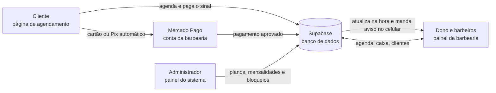

- Tudo acontece em tempo real: o que o cliente marca aparece na hora na agenda, e o que um barbeiro fecha no caixa aparece no celular do dono.
- O servidor confere cada agendamento: horário livre, dentro do expediente, fora do almoço, das folgas e dos bloqueios, soma o tempo e o preço dos serviços e calcula o sinal ele mesmo.
- Uma trava no banco impede dois clientes de pegarem o mesmo horário, mesmo que marquem no mesmo segundo.

---

## Segurança e privacidade

- **Cada barbearia só acessa os próprios dados**, com regras no banco de dados, não só escondendo na tela.
- O **barbeiro** só lê, cria e edita os agendamentos, comandas e vales dele. Não vê a agenda nem os ganhos dos colegas.
- O **cliente**, sem login, só vê o perfil público da barbearia e quais horários estão ocupados (sem nomes). Comissões e dados de outros clientes nunca aparecem pra ele.
- Cada WhatsApp só pode segurar uma reserva aguardando sinal por vez, pra ninguém travar a agenda.
- Só o administrador muda vencimento, mensalidade e bloqueio de uma barbearia.
- As chaves do Mercado Pago de cada barbearia ficam numa tabela que nenhum navegador consegue ler. O valor cobrado vem sempre do servidor, e um pagamento só confirma o horário depois de conferido direto no Mercado Pago.
- As fotos dos trabalhos ficam numa pasta por barbearia e por barbeiro, e só quem é da equipe consegue enviar ou apagar.

---

## Tecnologia

| Parte | O que usa |
|---|---|
| Telas | HTML, CSS e JavaScript puros, sem framework. Instalável no celular (PWA). Letra Bai Jamjuree |
| Banco de dados, login, tempo real e fotos | [Supabase](https://supabase.com) (Postgres com regras de acesso por linha, Storage) |
| Hospedagem | [Vercel](https://vercel.com) |
| Pix | Código "copia e cola" no padrão do Banco Central, gerado no próprio app (`pix.js`) |
| Cartão e Pix automático | [Mercado Pago](https://www.mercadopago.com.br/developers) (OAuth, Card Payment Brick e API de pagamentos) em Supabase Edge Functions |
| Avisos com o app fechado | Web Push (VAPID) numa Supabase Edge Function |
| QR codes | qrcodejs |
| Mascote e ícones | Desenhados em SVG |

```
├── index.html          Painel da barbearia (dono e barbeiros)
├── agendar.html        Página de agendamento do cliente
├── admin.html          Painel do administrador do sistema
├── termos.html         Termos de uso
├── privacidade.html    Política de privacidade (legal.css, legal.js)
├── pix.js              Gerador do Pix "copia e cola"
├── config.js           Endereço e chave pública do Supabase, contato de suporte
├── supabase/schema.sql Banco de dados, regras de acesso e funções
├── supabase/functions/ Mercado Pago (mp-oauth, mp-pagar, mp-webhook) e avisos no celular (push-enviar)
├── sw.js               Recebe os avisos com o app fechado
├── manifest.webmanifest, *.png   Nome e ícone do app no celular
└── docs/               Imagens deste README e guias técnicos
```

---

## Histórico de mudanças

| PR | O que mudou |
|---|---|
| #3 | Mercado Pago com um botão: cartão e Pix automático, sem comissão do app |
| #4 | Admin exclui barbearia e libera o e-mail |
| #5 | Mensagens de cartão recusado, devoluções, aviso com o app fechado, configurações do admin (planos, teste, tolerância, Pix) e cobrança no WhatsApp |
| #6 | Trava no banco contra dois agendamentos no mesmo horário |
| #7 | Fotos dos trabalhos dos barbeiros na página de agendamento |
| #8 | Checkup: extensão de rede no lugar certo, permissões e fotos apagadas ao excluir barbearia |
| #9 | Design v2 (preto com a cor da barbearia), agendamento em passos, vários serviços por horário e ícone novo |
| #10 | Nome **Degradê**, régua dos pentes, ícone em degradê; sai Estoque e Despesas |
| #11 | Lembretes de amanhã e na agenda do celular, termos e privacidade, versão clara do painel, manter conectado, aviso de senha no lugar certo e barbeiro vendo só a própria agenda |

---

## Próximos passos

- [x] Cartão de crédito e Pix automático pelo Mercado Pago, com confirmação automática do pagamento
- [x] Aviso de agendamento com o app fechado (notificação push)
- [x] Cobrança das mensalidades pelo WhatsApp com Pix, e planos com preço automático no admin
- [x] Vários serviços no mesmo agendamento
- [x] Lembrete do horário (WhatsApp com um toque e agenda do celular do cliente)
- [ ] Envio de e-mail próprio (cadastro e senha nova) com domínio do Degradê
- [ ] Endereço próprio do app (sair do jsbarberapp.vercel.app)
- [ ] Lembrete automático no WhatsApp pela API oficial
- [ ] Cartão fidelidade e clube de assinatura pros clientes da barbearia
- [ ] Agendamento de vários serviços pelo balcão
- [ ] Emissão de nota fiscal (NFS-e)

---

<p align="center">
  <br>
  <sub>Feito por <a href="https://github.com/SalesDevFull">SalesDevFull</a> · O guia técnico de instalação está em <a href="docs/INSTALACAO.md">docs/INSTALACAO.md</a></sub>
</p>
